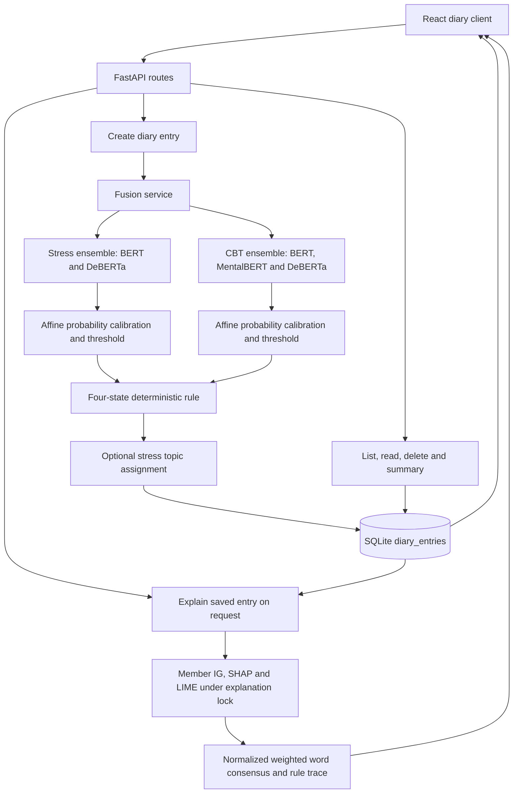
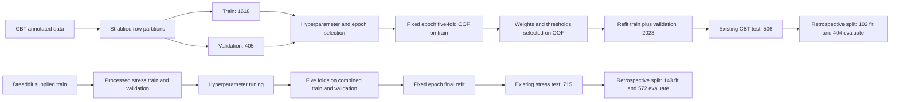

# Verified thesis evidence dossier — C3 Text Stress and Cognitive-Distortion Research

Prepared 9 October 2026 from repository HEAD `98e1d32`. This is an evidence collection and interpretation, not a finished thesis. The evidence supports a substantial draft, especially Chapters 3–7, but does not support declaring the submission complete, clinical effectiveness established, or the proposed SaaS commercially cleared.

The user’s pasted request controls the work. The supplied Word template and formatting PDF are sources of university expectations; their embedded example content and placeholders are not instructions to invent project facts. No training, expensive model inference, paid service, commit, push or modification of existing research/application artifacts was performed. Only this new directory contains deliverables. Private diary content, credentials, actual subject identifiers and personal declaration details are excluded. The local proposal is cited by its repository directory and page because its filename embeds personal details.

## Evidence conventions and source ledger

`implemented` means inspected current code, not proved deployed to an external server. `saved-result` means a historical artifact exists. `recomputed` means lightweight arithmetic, data inspection or a software check performed during this task; it does not mean retraining or regenerating predictions. `conflict` preserves incompatible artifacts. `proposed` means a plan or inferred candidate question, not accomplished work. `missing` means not located in the inspected evidence, not proof it never existed. A source can support more than one status.

Paths below are repository relative. Function references refer to current HEAD; notebook cells are physical one-based cells, including markdown cells. Tables retain experiment identity and denominator. Six-decimal presentation is rounded; full precision is retained in source artifacts and the verification calculations.

| Alias | Repository-relative source and role |
| --- | --- |
| P | `docs/proposal/` — sole individual proposal PDF, particularly literature/references pp. 1–5 and 23, methodology and business proposal pp. 6–19; filename withheld to avoid repeating personal identifiers |
| S | `ai_components/c3_text_stressor_distortion/Stress header/` — EDA/preprocessing notebooks, training, historical evaluation and XAI |
| C | `ai_components/c3_text_stressor_distortion/CBT header/` — analogous CBT research; `train/binary_classification/` is the active binary pipeline |
| B | `backend/c3_text_stressor_distortion/app/` — standalone diary API, predictor, calibration, fusion, explanations, topic assignment and SQLite |
| F | `frontend/c3_text_stressor_distortion/src/` — React diary client and explanation display |
| IS | `agent/backend/c3/stress/`, `agent/backend/c3/CBT/` — C3 in the shared agent integration |
| IA | `agent/backend/emotion_chain/`, `agent/backend/api.py`, `agent/backend/auth.py`, `agent/backend/tests/` — shared routing, fusion and access controls; not automatically individual work |

`AGENTS.md` and `BSC_THESIS_PROJECT_GUIDE.md` were not found in the repository or inspected parent locations. This gap did not stop inspection. Relevant root, backend, data, binary-training, XAI, BERTopic, calibration, fusion-report, test and agent deployment READMEs were read alongside the code and outputs.

## 1. Scope, objectives and individual contribution

`README.md` gives the wider project title **AI-Driven Multimodal Stress and Emotion Analysis with Explainable Intelligence** and identifies C3 as **Explainable Text-Based Stressor and Cognitive Distortion Detection**. “C3 Text Stress and Cognitive-Distortion Research” is the user’s working individual title. The official submission title still requires confirmation. The wider C1 physiological/BVP, C2 voice and C4 dialogue components are outside the individual C3 evidence boundary. The diary prototype and shared agent integration are distinct software contexts.

| Workstream | Actual evidence-supported capability | Maturity and boundary |
| --- | --- | --- |
| Stress | Binary stressed/not-stressed classifier with BERT, MentalBERT and DeBERTa-v3 research comparisons; deployed configuration uses BERT + DeBERTa-v3 | Final-refit checkpoints and historical evaluation saved; runtime implemented; live deployment not established |
| Auxiliary stressor proxy | Ten-class subreddit head in the stress training architecture | Experimental supervised community prediction; subreddit is a proxy, not ground-truth psychological cause; endpoint does not expose it |
| Cognitive distortion | Binary any-distortion/no-distortion transformer ensemble | Active binary pipeline with OOF selection and final-refit outputs; does not identify the ten distortion types at runtime |
| Distortion types | Legacy conditional type head, eleven-class metadata; new SLM SFT/QLoRA/RAG/DPO plans | Legacy code and proposed `train/distortion_type/` work; no completed new SLM model/evaluation located |
| Calibration | Affine logit transformation with transformed thresholds | Implemented and retrospectively evaluated on a partition of existing test data; not an independent new external test |
| Explanations | IG, SHAP and LIME member explanations, normalized weighted word consensus and rule trace | Implemented, with saved historical examples; no quantitative faithfulness, stability or clinician validation located |
| Fusion | Four deterministic states from two independent head decisions | Implemented rule; state coverage is saved, joint-label predictive accuracy is missing |
| Topics | BERTopic research and optional centroid-based stress-topic tags in the diary | Saved clustering outputs; inference is optional and threshold heuristic; no gold topic-label accuracy |
| Diary | Create/list/read/delete, stored predictions, summary/trend and on-demand explanation | Standalone React/FastAPI/SQLite prototype; no standalone account ownership controls shown |
| Shared agent | Text routing and other C1–C4 interfaces, portal authentication and alternative fusion | Shared integration; separate access control and fusion semantics; individual responsibility unconfirmed |

Sources: `README.md`; S `train/model.py`, `train/train.py`; C `train/model.py`, `train/binary_classification/train.py`, `train/distortion_type/README.md`; B `config.py`, `ensembles.py`, `calibration.py`, `fusion/`, `topic_model.py`, `diary.py`, `db.py`; `agent/backend/emotion_chain/agent_graph.py`.

The defensible completed objectives are to implement the two text classifiers, compare identifiable baseline/transformer runs, configure ensembles, implement calibration and decision fusion, expose explanations, and build a diary demonstration. “Improve all individual models,” “discover causal stressors,” “detect distortion types in the product,” “reduce patient distress” and “validate clinical use” are not completed objectives supported by these records.

Candidate research questions for the author to approve (these are reconstructed, not recovered signed-off questions):

1. How do TF-IDF baselines and the three transformer families compare on the two local benchmark partitions?
2. What trade-offs arise from the selected probability ensembles and thresholds relative to individual models?
3. Does retrospective affine calibration improve probability metrics while preserving decisions?
4. How can independent stress/distortion decisions and member-level attributions be presented transparently in a diary prototype?
5. What descriptive themes can BERTopic recover, and what limitations constrain their use as stressor tags?

Git history establishes file history only. It does not establish who conceived experiments, wrote each module, labelled data or contributed to the shared agent. No signed contribution allocation was located. Confirm formal name/student number, degree/specialisation, department, group, supervisor/co-supervisor, official title, submission date, individually authored modules, shared modules, reused libraries/data and acknowledgements. These details must be supplied privately for the eventual thesis, not inferred from the proposal, copyright line or commit authors.

## 2. Literature, bibliography verification and research gap

The proposal contains twelve numbered bibliography entries. Several place given names in surname positions. The following preserves the original identity/number while supplying only verified corrections. Verification was targeted primary-source lookup, not a systematic review: titles/authors were searched, then ACL Anthology, author arXiv records, publisher pages/PDFs and official model documentation checked. No exhaustive database protocol, screening log or review inclusion criteria were found.

| Proposal entry (P p. 23) | Verified record or unresolved metadata | Claim it can support; comparison limit |
| --- | --- | --- |
| [1] “S. Archie, K. Jeroen, Y. Helen”, survey, 2025 | Archie Sage, Jeroen Keppens, Helen Yannakoudakis. *A Survey of Cognitive Distortion Detection and Classification in NLP*. Findings of EMNLP 2025, pp. 14884–14899. DOI 10.18653/v1/2025.findings-emnlp.804. [Primary ACL record](https://aclanthology.org/2025.findings-emnlp.804/) | Taxonomy and prior NLP work; contradicts any unsupported “first distortion detector” claim |
| [2] “S. Benjamin … R. Parisa”, automatic detection/classification, BIBE 2020 | Benjamin Shickel, Scott Siegel, Martin Heesacker, Sherry Benton, Parisa Rashidi. Title/authors verified on 2019 preprint arXiv:1909.07502. Proposed 2020 proceedings venue/pages require publisher confirmation. [Author record](https://arxiv.org/abs/1909.07502) | Prior binary/type detection and interpretable word analysis; different datasets and weighted-F1 protocol, not a directly comparable score |
| [3] “W. Bichen … Q. Bing”, adolescent depression, 2023 | Bichen Wang, Yanyan Zhao, Xin Lu, Bing Qin. *Cognitive distortion based explainable depression detection and analysis technologies for the adolescent internet users on social media*. Frontiers in Public Health 10:1045777, published 17 Jan 2023; DOI uses 2022. [Publisher](https://www.frontiersin.org/journals/public-health/articles/10.3389/fpubh.2022.1045777/full) | Related CD-informed depression analysis; depression is not the C3 stress/distortion benchmark |
| [4] K. Crane, US statistics 2025 | Kayla Crane/South Denver Therapy blog located; title may have changed. [Blog](https://www.southdenvertherapy.com/blog/mental-health-statistics-2025) | Secondary context only; replace statistic claims with the original authoritative report; no clinical inference from blog |
| [5] “T. Elsbeth, M. Kathy”, Dreaddit, 2019 | Elsbeth Turcan, Kathleen McKeown. *Dreaddit: A Reddit Dataset for Stress Analysis*. LOUHI 2019, pp. 97–107. DOI 10.18653/v1/D19-6213. [ACL](https://aclanthology.org/D19-6213/) | Stress dataset provenance and annotation context; large unlabelled corpus is not the number of local labelled rows or participants |
| [6] “N. Tanya, A. Girija, T. Ananthakrishna”, 2022 | Tanya Nijhawan, Girija Attigeri, T. Ananthakrishna. *Stress detection using natural language processing and machine learning over social interactions*. Journal of Big Data 9:33. DOI 10.1186/s40537-022-00575-6. [Publisher](https://link.springer.com/article/10.1186/s40537-022-00575-6) | Relevant stress baseline literature; verify corpus/split/metric equivalence before comparison |
| [7] “G. Maarten”, BERTopic, 2022 | Maarten Grootendorst. *BERTopic: Neural topic modeling with a class-based TF-IDF procedure*. arXiv:2203.05794. [Author record](https://arxiv.org/abs/2203.05794) | Embedding/clustering/c-TF-IDF design; does not establish topic correctness in this corpus |
| [8] “L. Kamini, R. Shalli, S. Dr. Mohammad”, nested CV, 2026 | Kamini Lamba, Shalli Rani, Mohammad Shabaz. *Explainable machine learning for mental health prediction from social media behavior: a nested cross-validation study with SHAP and LIME interpretability*. Discover Mental Health 6:25, 22 Jan 2026. DOI 10.1007/s44192-026-00373-z. [Publisher](https://link.springer.com/article/10.1007/s44192-026-00373-z) | Comparison for nested evaluation/XAI; local C3 protocol must not be called nested CV merely because this paper is cited |
| [9] “M. A. Noor Ul … A. A. Syed”, NLP mental health, 2025 | Noor Ul Ain Mushtaq, Sanam Narejo, Syed Amjad Ali, Muhammad Moazzam Jawaid (publisher PDF order). *Explainable Machine Learning for Mental Health Detection Using NLP*. ADCAIJ 14:e32449, DOI 10.14201/adcaij.32449. [Publisher PDF](https://revistas.usal.es/cinco/index.php/2255-2863/article/download/32449/31106) | Related application; broad title does not establish superiority or diagnosis |
| [10] Pharmacally, WHO-report analysis, 2025 | Secondary blog located. [Article](https://pharmacally.com/global-mental-health-in-2025-evidence-gaps-and-the-way-forward-analysis-of-who-reports/) | Background only; retrieve the original WHO report before quoting global prevalence or treatment gaps |
| [11] “A. Mahmoud … H. Simo”, higher education BERTopic, 2025 | Mahmoud Ali, Niels van Berkel, Benjamin Tag, Ville Paananen, Jonas Oppenlaender, Koji Yatani, Simo Hosio. *Investigating mental wellbeing self-care in higher education using BERTopic modeling*. Discover Mental Health 5:204, published 23 Nov 2025. DOI 10.1007/s44192-025-00323-1. [Publisher](https://link.springer.com/article/10.1007/s44192-025-00323-1) | Related exploratory wellbeing topics; PMC is a repository, not the publication venue |
| [12] “T. S. Justin … -Z. B. Dror”, serious mental illness, 2023 | *Automated Detection of Cognitive Distortions in Text Exchanges Between Clinicians and People With Serious Mental Illness*. Psychiatric Services 74:407–410; DOI 10.1176/appi.ps.202100692. Title/DOI located; publisher blocked direct retrieval (403), full author list remains unverified. [Publisher record](https://psychiatryonline.org/doi/abs/10.1176/appi.ps.202100692) | Prior clinician-context work; cannot transfer clinical validation or consent to this project |

Important missing dataset citation: Sagarika Shreevastava and Peter Foltz, *Detecting Cognitive Distortions from Patient-Therapist Interactions*, CLPsych 2021, pp. 151–158, DOI 10.18653/v1/2021.clpsych-1.17. [Primary ACL record](https://aclanthology.org/2021.clpsych-1.17/). The local CBT README/metadata attributes this dataset, but a redistributed Kaggle copy is not proof of the original permissions or exact processing history.

Methodological references to add, with narrowly supported roles:

| Method | Verified primary source | Supports |
| --- | --- | --- |
| BERT | Devlin, Chang, Lee, Toutanova, NAACL 2019 pp. 4171–4186; DOI 10.18653/v1/N19-1423. [ACL](https://aclanthology.org/N19-1423/) | Encoder/pretraining family, not local fine-tuning results |
| MentalBERT | Ji, Zhang, Ansari, Fu, Tiwari, Cambria, *MentalBERT: Publicly Available Pretrained Language Models for Mental Healthcare*, LREC 2022. [ACL](https://aclanthology.org/2022.lrec-1.778/) | Domain-adaptive pretraining. [Official model card](https://huggingface.co/mental/mental-bert-base-uncased) says mental-health Reddit posts, not the local metadata’s unsupported Reddit+Twitter statement |
| DeBERTa-v3 | Pengcheng He, Jianfeng Gao, Weizhu Chen, *DeBERTaV3: Improving DeBERTa using ELECTRA-Style Pre-Training with Gradient-Disentangled Embedding Sharing*, arXiv:2111.09543; record identifies ICLR 2023 publication. [Author record](https://arxiv.org/abs/2111.09543) | Architecture/pretraining mechanism; specify cited version |
| Calibration | Guo, Pleiss, Sun, Weinberger, *On Calibration of Modern Neural Networks*, ICML 2017, PMLR 70:1321–1330. [PMLR](https://proceedings.mlr.press/v70/guo17a.html) | Motivation for calibration. C3’s added intercept makes its fitted method affine logit scaling, not plain one-parameter temperature scaling |
| Integrated Gradients | Sundararajan, Taly, Yan, *Axiomatic Attribution for Deep Networks*, ICML 2017, PMLR 70:3319–3328. [PMLR](https://proceedings.mlr.press/v70/sundararajan17a.html) | Attribution method; local normalized consensus does not retain completeness automatically |
| SHAP | Lundberg and Lee, *A Unified Approach to Interpreting Model Predictions*, NeurIPS 2017. [Primary paper](https://papers.nips.cc/paper/2017/file/8a20a8621978632d76c43dfd28b67767-Paper.pdf) | Shapley-based explanation framework; sampling/masking and aggregation still require local evaluation |
| LIME | Ribeiro, Singh, Guestrin, *“Why Should I Trust You?”: Explaining the Predictions of Any Classifier*, 2016, arXiv:1602.04938. [Author paper](https://arxiv.org/abs/1602.04938) | Local surrogate explanation; surrogate fit is not clinical correctness |

P’s introductory Dreaddit citation points to [3], whereas the dataset entry is [5]; citation numbering must be repaired. Broad XAI statements need the foundational method papers above rather than dataset/blog citations. The available literature already contains distortion detection, clustering and explainable mental-health work. The defensible gap is a bounded engineering/research question about the particular C3 comparison, OOF threshold selection, calibrated two-head interface and transparent prototype. A claim of unprecedented combination requires a documented search and a feature-by-feature comparison matrix. Compare dataset/task, target labels, input unit, split/grouping, model, averaging, calibration, XAI evaluation and deployment for each paper; do not rank papers by incompatible F1 values.

## 3. Data, preprocessing and evaluation independence

### 3.1 Provenance and actual counts

Stress inputs are local Dreaddit parquet files in `data/Stress header/raw/Dreaddit/`, attributed by `data/Stress header/README.md` to Turcan/McKeown and a Hugging Face redistribution. The raw training/test files contain 2,838/715 rows, respectively, with labels 0/1: 1,350/1,488 and 346/369. Total raw labelled rows are 3,553. The processed corpus contains 3,539 rows: fourteen raw-training rows do not remain in processed train+validation. These are text segments, not 3,553 distinct people. No licence/permissions document proving the local copy’s usage conditions was located.

CBT `data/CBT header/raw/Annotated_data.csv` has 2,530 rows. Raw fields are `Id_Number`, `Patient Question`, `Distorted part`, `Dominant Distortion`, `Secondary Distortion (Optional)`. The input to active classifiers is the patient question; therapist answers are excluded. The processed corpus has 2,529 rows, including 932 no-distortion rows rather than raw 933. The removed row’s reason should be recovered from a filter ledger before claiming an exact exclusion breakdown. No new local participant recruitment, consent or ethics approval is established by these datasets.

| Task | Partition | N | Negative | Positive | Source |
| --- | --- | --- | --- | --- | --- |
| Stress | train | 2258 | 1070 | 1188 | `data/Stress header/processed/dreaddit_train.csv` |
| Stress | val | 566 | 269 | 297 | `data/Stress header/processed/dreaddit_val.csv` |
| Stress | test | 715 | 346 | 369 | `data/Stress header/processed/dreaddit_test.csv` |
| CBT binary | train | 1618 | 596 | 1022 | `data/CBT header/processed/cbt_train.csv` |
| CBT binary | val | 405 | 149 | 256 | `data/CBT header/processed/cbt_val.csv` |
| CBT binary | test | 506 | 187 | 319 | `data/CBT header/processed/cbt_test.csv` |

The processed stress CSV has nine fields: `text`, three `text_for_*` variants, `label`, `subreddit`, `subreddit_label`, `confidence`, `sentiment`. Raw stress has 116 fields, including post/segment keys, community, annotation confidence, sentiment, LIWC and other lexical/social features. Only the selected text/labels and auxiliary subreddit head enter active transformer classification; presence of social features in the source is not proof they are model inputs.

The actual processed CBT CSV has **ten** fields, not an inferred eleven: row key, patient question, BERT/MentalBERT/DeBERTa/Longformer text variants, integer label, dominant distortion, annotated distorted span and secondary distortion. The secondary field is nonempty in 282/51/83 train/validation/test rows (416 total), but is metadata rather than an active target. Metadata retains eleven-class labels and Longformer although the deployed product is binary and has no Longformer checkpoint.

| Label | Dominant class | Train | Validation | Test | Total |
| --- | --- | --- | --- | --- | --- |
| 0 | No Distortion | 596 | 149 | 187 | 932 |
| 1 | All-or-nothing thinking | 64 | 16 | 20 | 100 |
| 2 | Overgeneralization | 153 | 38 | 48 | 239 |
| 3 | Mental filter | 78 | 20 | 24 | 122 |
| 4 | Should statements | 69 | 17 | 21 | 107 |
| 5 | Labeling | 105 | 27 | 33 | 165 |
| 6 | Personalization | 97 | 25 | 31 | 153 |
| 7 | Magnification | 125 | 31 | 39 | 195 |
| 8 | Emotional Reasoning | 86 | 21 | 27 | 134 |
| 9 | Mind Reading | 153 | 38 | 48 | 239 |
| 10 | Fortune-telling | 92 | 23 | 28 | 143 |

Sources for both tables: all six `data/{Stress header,CBT header}/processed/*_{train,val,test}.csv` files and their `metadata.json`; raw files above. Label mapping is from CBT metadata. Counts were read and recomputed during this task, without exposing text or key values.

### 3.2 Preprocessing and split order

Stress notebook `dreaddit_preprocessing.ipynb`: cell 3 selects columns; cells 4–7 implement contractions/cleaning/model-specific normalization; cell 8 assigns labels and class weights; cell 9 makes a stratified 20% validation split of the existing raw training set (seed 42); cell 10 applies nonempty/minimum-five-BERT-word quality filtering and training-only raw-text deduplication; cell 12 samples 300 training texts for token-length estimation, rounds the 95th percentile to a multiple of 64, capped at 512; saved stress limits are 192 for all three models; cell 14 writes CSV/metadata. The supplied raw test partition is retained, rather than creating a new test split.

CBT `cbt_preprocessing.ipynb`: cells 3–9 select input, exclude therapist responses, clean, encode dominant and secondary labels, and calculate legacy class weights; cell 10 makes a stratified 20% test split and then 20% validation within the remainder (seed 42, stratified by eleven-class dominant label); cell 11 applies filtering/training-only deduplication; cell 13 estimates token limits, with a fuller Longformer scan; cell 15 saves. Splits are approximately 64/16/20%, not a 60/20/20 split. Metadata weights made before splits belong to the historical eleven-class pipeline; the active binary training code separately computes binary training/fold weights.

B `preprocessing.py` functions `expand_contractions`, `remove_noise`, `_preprocess`, `preprocess_stress_text` and `preprocess_cbt_text` reproduce saved processed strings on every existing row for BERT, MentalBERT and DeBERTa-v3: **18,204 comparisons, zero mismatches and no empty runtime outputs**. This verifies existing data normalization, not fresh input tokenization/model prediction equivalence. Lowercasing, 68 contraction patterns, URL/email/HTML removal, repeated-character reduction to two characters, repeated punctuation normalization and ASCII-oriented allowed characters are used. Stress additionally removes Reddit mentions. DeBERTa removes standalone lowercase letters, which can remove “I” after lowercasing and the article “a”; preserving all psychological cues cannot be claimed. No classifier stopword removal or lemmatization is used. `train/augmentation.py` and `train/dataset.py` in S/C implement training-only synonym replacement with probability 0.15 and at most one replacement; there is no evidence of multilingual augmentation or an augmentation ablation.

The active CBT limits are BERT 512, MentalBERT 512, DeBERTa-v3 448 (`models/c3_text_stressor_distortion/CBT header/binary_config.json` and B `config.py`). Longformer 1344 is legacy metadata. Nested saved hyperparameters can contain stale `MAX_LEN=192`; the operative per-model `max_len`/dataset configuration takes precedence. No exact truncation-rate evaluation or truncated-span error study was recovered. ASCII cleanup and English pretrained models restrict generalisation to Sri Lankan multilingual/code-switched diary text.

### 3.3 Exact overlap, duplicated rows and grouping

Exact comparison preserves stored strings. The second comparison strips/collapses Unicode whitespace and applies `casefold()` using `' '.join(text.split()).casefold()`. No punctuation deletion, semantic comparison or near-duplicate search was used for this overlap check. Distinct shared values and counts of rows carrying those values are reported separately; zero identical complete rows does not imply zero shared inputs.

| Task | Partition pair | Distinct shared raw values | Rows first | Rows second | Identical full-row values | Shared values with differing label sets |
| --- | --- | --- | --- | --- | --- | --- |
| stress | train–val | 5 | 5 | 6 | 0 | 2 |
| stress | train–test | 2 | 2 | 2 | 0 | 2 |
| stress | val–test | 1 | 1 | 1 | 0 | 1 |
| cbt | train–val | 0 | 0 | 0 | 0 | 0 |
| cbt | train–test | 0 | 0 | 0 | 0 | 0 |
| cbt | val–test | 0 | 0 | 0 | 0 | 0 |

For raw stress text these values are unchanged by whitespace/case normalization. BERT/DeBERTa processed-text shared value counts are also 5/2/1; training/validation processed-text overlap spans six rows in each partition because another input collapses to a shared processed value. Stress validation has 566 rows but 565 distinct raw strings. There are no identical complete-row duplicates within any of the six processed partitions or across the inspected pairs. CBT raw and inspected processed text have zero exact and normalized overlap across all pairs. This does not establish patient independence or absence of paraphrases.

Stress final refit combines train+validation: its inputs share **three distinct raw text values** with the test partition. Two train/test values and one validation/test value have different binary label sets across partitions. Such contradictions are both independence and annotation-consistency concerns; no effect size is assumed. Raw stress `post_id` groups are disjoint between raw train and raw test (2,343/586 distinct posts, zero shared). However, processed files drop post identifiers. Recovery through unique raw-text-to-post mappings confirms at least **143 shared posts between internal train and validation**; including ambiguous mappings yields 153 possible shared posts. This recovery does not expose identifiers. Row-stratified CV and tuning are therefore not demonstrated post-independent. Original test post disjointness does not cancel shared segment strings, and neither establishes author independence. CBT’s `Id_Number` is a record key, not a verified patient identifier. No grouped CBT split, speaker/author grouping or near-duplicate exclusion is established.

Essential reporting correction: describe the current evaluation as the saved row-based benchmark protocol with these limitations. A group-aware/duplicate-audited evaluation would be a new experiment and must be authorised and reported separately; do not revise old metrics silently.

## 4. Research methodology and artifact identity

### 4.1 Baselines and transformer heads

S `train/baselines.py` and C `train/binary_classification/binary_baselines.py` use raw text with TF-IDF up to 50,000 features, word n-grams (1,2), minimum document frequency 2, maximum 0.95, sublinear TF and lowercasing. Logistic regression uses C=1, balanced classes, lbfgs and max_iter=1000; LinearSVC uses C=1 and balanced classes, with three-fold `CalibratedClassifierCV` for probabilities. Stress baselines fit on train+validation (2,824 rows) and report test performance (715). CBT baseline OOF vectorizers fit independently on each outer training fold, then final baseline refit uses train+validation (2,023), test 506. TF-IDF is fitted before the inner SVM calibration split, so vocabulary/IDF use all of that outer training set including the internal calibration texts; outer test leakage through TF-IDF is not shown, but fully isolated inner calibration preprocessing is not established.

S `train/model.py` wraps a pretrained encoder, CLS pooling, normalization/dropout, and two feed-forward heads (hidden 768 → intermediate 256, GELU, head dropout 0.1 → two stress logits or ten subreddit logits). Weighted cross-entropy and label smoothing 0.1 are combined as `alpha * stress_loss + (1-alpha) * subreddit_loss` in S `train/trainer.py`; the selected alpha, not an example default in prose, defines the run. The deployed ensemble consumes the binary head. C `train/model.py` retains a legacy binary-plus-conditional-type architecture; `BinaryCDTModel` in C `train/model.py` is the active two-logit encoder/head classifier, with any dominant label other than zero mapped positive. Secondary distortion/span annotations are not active classifier inputs or multi-label targets.

Layer-wise AdamW learning rates decay through encoder depth, with head multiplier 10, no bias/LayerNorm weight decay, cosine schedule and warmup. Saved common settings: weight decay 0.01, max gradient norm 1, warmup ratio 0.1, accumulation 2, intermediate 256, head dropout 0.1, label smoothing 0.1 and epoch cap 10. Source: S `train/trainer.py`, `train/config.py`; C `train/binary_classification/training.py`, `train/config.py`. Mixed precision is hardware-dependent; the saved runs and current CPU audit environment must not be conflated.

The saved stress binary class weights are [1.0511, 0.9536], and its ten-class auxiliary weights are [3.5475, 0.5642, 0.982, 0.8981, 7.6703, 1.6893, 0.486, 0.5141, 4.4344, 1.1584] in `data/Stress header/processed/metadata.json`; they were calculated before the internal validation split. CBT `models/c3_text_stressor_distortion/CBT header/binary_config.json:training` saves real-training binary weights [1.3573825359344482, 0.7915851473808289]. C `train/binary_classification/train.py:build_binary_criterion` recomputes N/(2*class_count) for each training fold and separately for final train+validation. This differs from the historical eleven-class CBT metadata weights. The binary config records no synthetic-data use; synonym augmentation of real training text is a separate procedure. MentalBERT’s runtime BERT scaffold (`runtime_hf_id`) reconstructs the same architecture before loading the fine-tuned MentalBERT state strictly; it does not establish replacement by vanilla BERT weights. Source: B `ensembles.py:load`, CBT `train/model.py:_load_encoder` and `binary_config.json`.

### 4.2 Selection, OOF and final refit

Stress S `train/tuner.py` uses ten Optuna trials, two proxy epochs, TPE seed 42 and median pruning on training/validation. S `train/kfold.py` then uses five stratified folds on combined train+validation, early stopping by macro-F1 (patience two). Rounded mean best-fold epochs determine fixed final-refit budgets: BERT [6,3,2,5,3] → 4; MentalBERT [2,9,3,4,3] → 4; DeBERTa-v3 [7,3,5,4,6] → 5. Fold performance is not a nested-CV generalisation estimate after earlier hyperparameter tuning on overlapping combined data. Historical `mean_val_f1` for stress baselines and ensemble is actually test macro-F1 with artificial std=0; rename in the thesis, not in these untouched artifacts.

There is a code-supported checkpoint defect: S `train/trainer.py:fit` saves the best epoch to a fold path but does not restore its weights before returning. S `train/kfold.py` around lines 93–104 saves the current model state as the overall `_best.pt` after comparing the recorded best score. That file can therefore contain the final early-stop epoch rather than the selected best epoch. This affects claims about `_best.pt`; it does not by itself establish a defect in separate `_final.pt` refit artifacts. S `train/trainer.py:fit_fixed_epochs` builds the scheduler from the ten-epoch hyperparameter setting rather than the actual four/five-epoch budget. Report this actual schedule and correct it before any future regenerated run; do not infer an unmeasured performance impact. Stress main seeds NumPy/Torch but does not explicitly seed Python `random` used in synonym augmentation, limiting full reproducibility.

The stress equal-weight BERT/DeBERTa-v3 ensemble is fixed in S `train/train.py` and B `config.py`. No saved rowwise stress OOF ensemble-weight search or justification for excluding MentalBERT was located. Do not call it OOF-optimised or the best macro-F1 model.

CBT C `train/binary_classification/train.py` selects hyperparameters and best epoch with the dedicated validation split, then performs five-fold OOF predictions on the real training split only (1,618 rows), training each fold for the fixed selected epoch budget rather than selecting a checkpoint against that outer fold’s held-out labels. Fold sizes in saved logs are 324,324,324,323,323. Binary class weights are computed from each training fold; the separate final-refit criterion is computed from full train+validation, not from test labels. Threshold search uses 0.20–0.80 in steps of 0.01 (61 choices), ranking macro-F1, accuracy, MCC, then closeness to 0.5. Positive ensemble weights in increments of 0.1 sum to one, with every member at least 0.1; there are 36 candidate triples. Selection also favours proximity to equal weights as a tie-break. Selected weights are 0.1/0.4/0.5, threshold 0.37, OOF macro-F1 0.741403, accuracy 0.762670, MCC 0.483750. All OOF probabilities participate in weight/threshold selection, so the selected OOF score is a selection score, not an untouched test estimate.

Saved CBT individual OOF selection summaries (macro-F1 at selected threshold): LR 0.698641 (0.50), SVM 0.686181 (0.62), BERT 0.693827 (0.48), MentalBERT 0.725381 (0.35), DeBERTa-v3 0.728356 (0.33). These are recovered summary comparisons from `reports/c3_text_stressor_distortion/CBT header/binary_v4/all_results.json`, not reconstructed rowwise OOF predictions. No retained rowwise 1,618-row OOF file with fold membership/probabilities was located; alternative ensembles, zero-weight models, broader grids or unbiased selection comparisons cannot be recovered from summary scores alone. Final refit uses 2,023 rows for BERT/MentalBERT/DeBERTa-v3 for 1/7/5 epochs, respectively. “Minimum five epochs” is a minimum training duration before early stopping, not a rule forcing selected best epoch ≥5; BERT’s selected epoch one is consistent with that code.

| Task | Model | Batch | Learning rate | Encoder dropout | Layer LR decay | Stress loss alpha | Token limit | Refit epochs |
| --- | --- | --- | --- | --- | --- | --- | --- | --- |
| Stress | BERT | 8 | 1.132039114e-05 | 0.414070 | 0.877135 | 0.479870 | 192 | 4 |
| CBT | BERT | 16 | 9.781801964e-06 | 0.480286 | 0.909799 | binary only | 512 | 1 |
| Stress | MentalBERT | 8 | 1.132039114e-05 | 0.414070 | 0.877135 | 0.479870 | 192 | 4 |
| CBT | MentalBERT | 32 | 2.360402442e-05 | 0.340446 | 0.906211 | binary only | 512 | 7 |
| Stress | DeBERTa-v3 | 8 | 5.618106695e-06 | 0.479554 | 0.921260 | 0.786253 | 192 | 5 |
| CBT | DeBERTa-v3 | 32 | 2.360402442e-05 | 0.340446 | 0.906211 | binary only | 448 | 5 |

Stress values come from `models/c3_text_stressor_distortion/Stress header/all_results.json`; CBT values from `reports/c3_text_stressor_distortion/CBT header/binary_v4/all_results.json` with operative lengths from `models/c3_text_stressor_distortion/CBT header/binary_config.json`. Current CBT default batch choices 8/16 differ from saved MentalBERT/DeBERTa batch 32. A supported `CBT_BATCH_SIZE_CHOICES` override could explain this, but no actual invocation/environment record establishes it. Identical selected hyperparameters for two families are recorded as saved facts, not proof of independent tuning or illicit reuse. Recover Optuna trial history and execution manifests.

### 4.3 Metrics and experiment registry

Binary CM notation throughout is `[[TN, FP], [FN, TP]]`, true labels on rows, predictions on columns, positive = stress/distortion. Accuracy = (TN+TP)/N. Per-class F1 = 2PR/(P+R); macro-F1 is the unweighted mean of negative and positive class F1; positive-F1 is a different metric. Balanced accuracy is mean sensitivity/specificity (binary macro recall). MCC uses all four CM cells. ROC-AUC uses continuous positive probabilities; `pr_auc` in the checked CBT code is `average_precision_score`, not trapezoidal area under a plotted PR curve. Weighted-F1 weights class F1 by support. Zero-division handling must follow the evaluation implementation, not an invented formula.

Calibration ECE is positive-class, fifteen equal-width bins weighted by sample fraction, comparing mean positive probability with observed positive frequency; it is not top-label-confidence ECE. Brier is mean squared positive-probability error, NLL binary log loss. Source: B `calibration.py:calibration_metrics`; C binary `utils`/evaluation and S `train/utils.py`. No confidence intervals, significance tests or model-pair uncertainty evaluation were found.

| ID | Identity, denominator and artifact | Interpretation |
| --- | --- | --- |
| S-REFIT | `models/c3_text_stressor_distortion/Stress header/all_results.json`, test N=715; `_final.pt` for transformers, baseline refits, equal-weight ensemble | Historical final-refit report; final rowwise transformer/ensemble predictions not retained here, so most metrics are saved rather than independently recomputed |
| S-BEST | Same JSON `best_fold_test_*` arrays and `_best.pt`; N=715 | Historical selected-fold diagnostic, distinct from refit; checkpoint selection defect prevents treating filename as proof of best epoch |
| S-LATER | `reports/c3_text_stressor_distortion/Stress header/evaluation/{metrics,error_analysis}/`, `combined_predictions.csv`; N=715; notebook selects `_best.pt` | Later evaluation, positive-F1 in its report; recomputed from saved predictions; differs from S-REFIT |
| CBT-V4 | `reports/c3_text_stressor_distortion/CBT header/binary_v4/{all_results.json,binary_test_predictions.csv}`; N=506; final binary checkpoints | Primary internally consistent saved binary-refit artifact set; OOF selection distinct |
| CBT-LATER | `reports/c3_text_stressor_distortion/CBT header/evaluation/`; N=506, same checkpoint filenames but no contemporaneous hash manifest | Recomputed later outputs, positive-F1 report; baseline/transformer disagreements unresolved |
| CAL-S | `reports/c3_text_stressor_distortion/Calibration/stress/`; original test 715 → calibration 143/evaluation 572 | Retrospective probability experiment; raw probabilities differ slightly from S-REFIT |
| CAL-C | `reports/c3_text_stressor_distortion/Calibration/cbt/`; original test 506 → calibration 102/evaluation 404 | Retrospective probability experiment; differs from CBT-V4 even before calibration |
| TOPIC-S / TOPIC-C | `reports/c3_text_stressor_distortion/{Stress header,CBT header}/BERTopic/` and corresponding models | Descriptive unsupervised clustering of selected training inputs, not classification accuracy |
| FUSION-HIST | `reports/c3_text_stressor_distortion/Fusion/`, N=60 prediction timings/four explanations | Historical in-process coverage/latency, not HTTP/browser load or joint-label accuracy |
| DEMO | `test/c3_text_stressor_distortion/report/summary.json`, ten handcrafted cases per head | Small software demonstration, not independent benchmark/user/clinical validation |
| AUDIT-2026-10-09 | Current lightweight checks in `VERIFICATION_LOG.md` | Static/data/arithmetic/software verification; no model inference |

Hashes recorded now identify present artifacts, not the exact bytes at historical generation. The log contains 273 SHA-256/size entries including data, outputs and checkpoints. Five deployed research checkpoints are byte-identical to their corresponding `agent/model/c3/` copies; copied binary configuration/calibration artifacts also match. Model identifiers do not pin upstream revisions. Full environment locks, model/tokenizer revisions, experiment commit, invocation and generation-time checkpoint hashes are still missing.

## 5. Product and solution design

### 5.1 Requirements derived from current code

These are reconstructed requirements, not a signed requirements document or proof of stakeholder agreement.

| Requirement | Implementation source | Available verification / gap |
| --- | --- | --- |
| Predict two binary text signals | B `main.py`, `ensembles.py`, `predictors.py` | Saved benchmark outputs and configuration; actual current model loading/inference not run |
| Return a transparent combined state | B `fusion/decision.py:decide_fusion`, `fusion/service.py:analyze`, `fusion/router.py` | Four-case rule arithmetic checked; no dual-label gold set |
| Explain saved entries on request | B `fusion/xai_service.py`, `explainer.py`, `fusion/router.py`; F `features/fusion/FusionExplanation.jsx` | Mock aggregation contract test passes; current real five-member XAI not executed |
| Save and browse diary entries | B `diary.py`, `db.py`; F `App.jsx`, `api.js` | Direct scratch SQLite CRUD/reload check (13 assertions) and frontend build pass; live browser acceptance missing |
| Show totals and recent trends | B `db.py:summary`; F `App.jsx:InsightsPage`, `components/TrendChart.jsx` | Fourteen-day UTC aggregation code; no patient improvement measure |
| Permit deletion with confirmation | B `diary.py:delete_entry`; F `components/ConfirmDeleteButton.jsx` | Code-supported; backup deletion/retention policy missing |
| Topic failure must not block otherwise successful save | B `diary.py:create_entry` | Catch/log optional topic failure; core prediction failure stops insert |
| Consistent preprocessing and calibrated thresholds | B `preprocessing.py`, `calibration.py`, `config.py` | Whole existing-corpus string parity and saved probability checks pass |
| Recover from partial explanation failure | B `fusion/xai_service.py` | Per-member error collection and `partial`/`rule_only` status; stress testing missing |
| Responsive frontend and understandable evidence | F `styles.css`, `features/fusion/TokenEvidence.jsx` | Production build passes; usability/accessibility/browser/device validation missing |
| Privacy, safe clinical boundaries and multi-user access | Standalone B lacks auth/user ownership; IA has separate authentication | No standalone privacy/security validation; shared agent controls cannot be attributed to diary |
| Low latency, availability and sustainable cost | Saved fusion timings; `agent/DEPLOYMENT.md`; P pp. 15–19 | No load/SLA/billing evidence; resource/cost targets remain proposals |

### 5.2 Code-supported architecture and flow

The first diagram describes the standalone prototype. Sources: F `api.js`; B `main.py`, `diary.py`, `db.py`, `predictors.py`, `fusion/service.py`, `ensembles.py`, `topic_model.py`, `fusion/xai_service.py`.

The second diagram describes actual selection/evaluation boundaries, not a claim of complete isolation. Sources: S `train/train.py`, `train/kfold.py`, `train/trainer.py`; C `train/binary_classification/train.py`; `ai_components/c3_text_stressor_distortion/calibration/evaluate_and_fit.py`.

### 5.3 Probability, calibration and rule calculations

B `ensembles.py:predict_proba_raw` obtains each member’s two-class softmax and adds configured weighted probabilities, sequentially. Stress `p = 0.5*p_BERT + 0.5*p_DeBERTa`, original positive threshold 0.5. CBT `p = 0.1*p_BERT + 0.4*p_MentalBERT + 0.5*p_DeBERTa`, original threshold 0.37. Current weights sum to one; generic standalone code does not enforce arbitrary weight normalization/validity, so this is a configuration-supported property. CBT saved ensemble probability arithmetic agrees within 2.22e-16.

B `calibration.py:apply_temperature` computes `q = sigmoid(logit(clip(p, 1e-7, 1-1e-7))/T + b)`. `fit_affine_temperature` fits logistic regression to logit(p), requires a positive fitted slope (otherwise rejects the fit), and maps slope to T; the saved intercept b is nonzero. It is affine logit calibration, despite “temperature scaling” labels in older plots. The threshold is transformed by the same function: `t_new = sigmoid(logit(t_old)/T + b)`. Because this mapping is strictly increasing, comparison with t_new preserves the original decisions. The returned confidence is the probability of the selected class; with non-0.5 thresholds it need not be the maximum class probability.

| Head | T | Bias | Original threshold | Calibrated threshold | Source |
| --- | --- | --- | --- | --- | --- |
| Stress | 1.199939962084714 | -0.4101923167261747 | 0.50 | 0.3988660081050319 | `models/c3_text_stressor_distortion/Stress header/stress_ensemble_calibration.json` |
| CBT | 0.6438634788595559 | 0.7711035856525978 | 0.37 | 0.4861297424491946 | `models/c3_text_stressor_distortion/CBT header/binary_ensemble_calibration.json` |

B `fusion/decision.py:decide_fusion` maps binary flags as below. It learns no parameters and makes no severity/causal/diagnostic claim.

| Stress | Distortion | State |
| --- | --- | --- |
| false | false | `no_signal` |
| true | false | `stress_only` |
| false | true | `distortion_only` |
| true | true | `stress_with_distortion` |

The shared agent has another fusion operation: `agent/backend/emotion_chain/fusion.py:fuse_stress_and_cbt` supports weighted probability/default threshold, OR and single-head ablations. `agent_graph.py` passes raw head flags for ablations. This is not the standalone four-state rule, and its probability is not a validated joint clinical probability. `agent/backend/api.py` uses `Depends(protect_api)` and portal account logic; no such authentication is present in the standalone B routes.

### 5.4 API contracts, persistence and error handling

| Route | Input / output / failure boundary | Source |
| --- | --- | --- |
| `GET /api/health` | Status plus checkpoint/calibration/load metadata; returns ok without proving models loaded or ready | B `main.py:health` |
| `POST /api/predict` | `text`, 1–4000 characters; stress prediction | B `main.py` |
| `POST /api/predict/distortion` | `text`, 1–4000; binary CBT prediction | B `main.py` |
| `POST /api/fusion/predict` | `text`, 1–8000; independent head labels/detected/confidence/probabilities plus rule state/summary/method | B `fusion/router.py`, `fusion/schemas.py` |
| `POST /api/diary` | `content`, 1–8000; optional `title` ≤200; predicts both heads then saves, optional topic | B `diary.py:DiaryEntryCreate`, `create_entry` |
| `GET /api/diary` | `limit=50`, `offset=0`; list; pagination values lack explicit lower/upper bounds | B `diary.py:list_entries` |
| `GET /api/diary/summary` | Totals, stress/distortion percentages, fourteen UTC dates | B `db.py:summary` |
| `GET /api/diary/{id}` / `DELETE` | Entry / deletion status; missing entry 404 | B `diary.py` |
| `POST /api/diary/{id}/explain` | Rule trace, per-head evidence, IG/SHAP/LIME features, consensus/agreement, LIME R², members/errors and complete/partial/rule_only | B `fusion/router.py`, `fusion/schemas.py` |

Pydantic length constraints validate character counts; whitespace-only semantic handling is deferred to preprocessing. Exceptions from core inference become HTTP 500 and can contain exception strings/filesystem details. CORS permits local port 5173; CORS is not authentication. F `api.js` wraps fetch and surfaces errors; `App.jsx` supplies today/timeline/insights flows. The build proves bundling only.

B `db.py:init_db` creates `diary_entries` with integer key, UTC created timestamp, title/content, each head label/flag/confidence and JSON probabilities, and optional topic theme/similarity/JSON terms. Parameterized SQL is used for entry operations. There is no user owner key, model/checkpoint revision, calibration revision, stored explanation revision, explicit retention policy, at-rest application encryption or schema migration framework demonstrated. Fusion state is derived on read from stored flags using current rule code. The explanation endpoint targets stored historical labels but explains **current** model weights rather than storing the generation-time model identity or rescoring first. Model updates can therefore produce explanations that no longer describe the decision originally saved. Database files and private diary entries were not read during this task.

### 5.5 Attribution aggregation and topic enrichment

B `fusion/xai_service.py` attempts every deployed member, using IG (default 50 steps), SHAP and LIME (default 1000 samples), under a shared explanation lock. It explains each head’s selected class. `_normalise` scales each method/member by maximum absolute score; `_align_method` case-folds/strips outer punctuation and aligns repeated word occurrences with queues. Canonical words come from the first successful member, with absent later scores filled by zero; unique later words can be omitted. `_aggregate_member_results` combines surviving members using renormalized ensemble weights, then equally averages the three method scores into consensus and records sign agreement. Top evidence is serialized and a deterministic rule reason accompanies it. Source: B `fusion/xai_service.py` around functions at lines 114,124,144,189,216; `explainer.py` feature serialization. Individual member failures are collected; a partial result or rule-only fallback can still return.

The resulting word scores are useful model-behaviour summaries, not an exact additive decomposition of the calibrated ensemble probability. Normalization, token alignment, omission and method averaging mean IG completeness/SHAP additivity cannot simply be asserted. Neither per-token rationale correctness nor sign agreement across methods proves expert agreement. The saved single-member XAI examples do not establish current five-member ensemble faithfulness. Prediction paths are not serialized by the explanation lock, so concurrent inference/autograd safety remains untested.

Stress and CBT BERTopic configurations/results live in `reports/c3_text_stressor_distortion/{Stress header,CBT header}/BERTopic/run_config.json` and corresponding models. They use `sentence-transformers/all-mpnet-base-v2`, UMAP (15 neighbours, five dimensions, cosine/min_dist=0), HDBSCAN (min_cluster_size=15, min_samples=3, leaf, Euclidean), English count-vectorizer n-grams 1–2 (min_df=3/max_df=0.9), BM25-style c-TF-IDF/frequent-word reduction, KeyBERTInspired/MMR 0.5 representations and seed 42. Stress class labels/subreddits are used only for post-fit summaries, not fitting. CBT uses annotated spans for corpus selection without passing distortion labels to clustering. Both runs use a 1.2 representation-term multiplier; embedding-level seed-topic guidance is disabled in the saved configurations. Fitting uses training texts and transforms other partitions; no gold-topic classification experiment follows from this.

B `topic_model.py` uses saved stress topic centroids and CPU sentence embeddings with cosine similarity, excludes outlier topic, and emits a clear tag only above 0.48. Its comment describes a heuristic threshold adjustment, not a validated operating point. It is not the complete offline UMAP/HDBSCAN prediction pipeline, and not a distortion type classifier. Source/output defaults with underscore directory names in research BERTopic scripts differ from the saved `Stress header/BERTopic` layout; exact executed commands/configs are needed to reproduce the historical arrangement.

## 6. Implementation, integration, tests and deployment

B `config.py` resolves local base model scaffolds at `agent/model/c3/base_models`, research checkpoint paths and calibration JSON. B `ensembles.py:load_state_dict` supports wrapper/module-prefix removal; `load` lazily loads under a lock, reconstructs the model head dimensions, loads state strictly, moves to configured device and uses eval mode. Missing checkpoints fail explicitly; calibration JSON is loaded during predictor construction and missing/inconsistent calibration can fail import/startup. `torch.load(weights_only=True)` is attempted, with an older-library fallback; no model pickle/checkpoint was loaded during this audit. `main.py` initializes SQLite at import, so any future run must override `DIARY_DB_PATH` to a scratch location before import if preserving real diary data.

The current standalone README startup command is `uvicorn app.main:app --app-dir backend/c3_text_stressor_distortion --host 0.0.0.0 --port 8005` after dependency installation. It was not run as a public server. Device selection and external HF cache/download behaviour depend on installed libraries and assets. File existence and strict-load code inspection do not prove every tokenizer/model loads offline. Health is observability, not a readiness guarantee.

| Evidence layer | What is established | What is not established |
| --- | --- | --- |
| Existing tests | `test/c3_text_stressor_distortion/test_runtime_contract.py`; sample-text real-model tests/report generators; shared `agent/backend/tests/` modules | Presence is not evidence every suite passed historically |
| Run now | Five runtime-contract tests, ten shared pure fusion tests and thirteen direct SQLite assertions pass; 101 Python files parse; frontend production build passes to `/tmp` | No current encoder inference, real attribution, GPU run or browser acceptance |
| Data/arithmetic checks | Counts, distributions, overlap, normalization parity, saved-prediction CMs/metrics, ensemble arithmetic and calibration mapping reproduced | No retraining, independent external validation or original experiment reproduction |
| Saved demo | Stress 10/10 and CBT 8/10 handcrafted examples; report success=false | Not benchmark/user/clinical validation |
| API/persistence smoke | Temporary SQLite and mocked classifiers attempted; TestClient and async-ASGI attempts timed out before completed assertion report | API transport/persistence end-to-end success is unresolved; no pass is claimed |
| Deployment documentation | `agent/backend/README.md`, `agent/DEPLOYMENT.md`, requirements and profile configurations | No current external endpoint, uptime, penetration test, recovery drill or usage record established |

The saved CBT V4 log reports an NVIDIA A100-SXM4-80GB and approximately 37m43s of relative log time. The truncated stress log reports an RTX 3050 Laptop GPU around 6.1 decimal GB but ends during early tuning; it cannot establish hardware/duration for the complete final run. BERTopic saved run configuration records Torch 2.7.1+cu128. Current audit environment is Python 3.12.3, Torch 2.3.0+cpu and Transformers 4.40.0; this is verification hardware/software, not the original training environment. Full versions and discrepancies are in the log. `agent/DEPLOYMENT.md` discusses RTX 3080 12GB/64GB RAM and shared LLM memory; these are separate deployment claims, not evidence about individual C3 training.

A direct SQLite check with synthetic data passed thirteen assertions covering insert/list/get/delete, JSON/flag/fusion reconstruction, pagination, summary, and module reload against the same scratch file. This is persistence-layer evidence, not API transport or browser proof. No actual browser screenshots were located among inspected C3 artifacts. Aggregate figures and logs exist; saved XAI/BERTopic example outputs can reveal sensitive source text and need privacy review before reproduction. Required future checks include scratch-database CRUD/API routing, core/topic failure isolation, corrupted/missing checkpoint startup, real offline loading, actual current ensemble/XAI integration, stored-decision provenance on model updates, bounded pagination, concurrent explanation/prediction, frontend network-failure handling and browser/device/accessibility acceptance. Existing shared portal/security test code must be distinguished from standalone diary controls and individual contribution.

## 7. Results and validation

### 7.1 Historical stress final-refit comparison (S-REFIT)

| Model | N | Threshold | Accuracy | Macro-F1 | MCC | ROC-AUC |
| --- | --- | --- | --- | --- | --- | --- |
| LR | 715 | 0.50 | 0.717483 | 0.716149 | 0.434210 | 0.820629 |
| SVM | 715 | 0.50 | 0.730070 | 0.728282 | 0.460101 | 0.822869 |
| BERT | 715 | 0.50 | 0.780420 | 0.778756 | 0.562221 | 0.875386 |
| MentalBERT | 715 | 0.50 | 0.809790 | 0.807674 | 0.624109 | 0.895202 |
| DeBERTa-v3 | 715 | 0.50 | 0.806993 | 0.805578 | 0.615779 | 0.896298 |
| Ensemble_BERT_DeBERTa-v3 | 715 | 0.50 | 0.802797 | 0.801580 | 0.606620 | 0.896784 |

Source for every cell: `models/c3_text_stressor_distortion/Stress header/all_results.json`, `test_metrics`; N=715, threshold 0.5 for binary transformer/ensemble decisions. These are saved reports, not freshly inferred/recomputed final predictions. Mean fold macro-F1 ± fold SD for BERT/MentalBERT/DeBERTa-v3 is 0.819660 ±0.016835 / 0.831191 ±0.012020 / 0.835194 ±0.006755. These SDs are not confidence intervals and are not interchangeable with test uncertainty. Auxiliary subreddit final accuracy/macro-F1 is BERT 0.551049/0.451666; MentalBERT 0.560839/0.453390; DeBERTa-v3 0.302098/0.200884. This is community prediction, not validated causal stressor detection.

MentalBERT has the strongest saved S-REFIT macro-F1 and accuracy; the deployed two-model ensemble has slightly higher saved ROC-AUC but lower macro-F1 than MentalBERT and DeBERTa-v3. It therefore cannot be reported as uniformly superior. The ensemble’s member selection may reflect a design constraint, but no measured cost/ablation rationale was located.

### 7.1a Saved selected-fold diagnostics (S-BEST)

| Model | N | CM [[TN,FP],[FN,TP]] | Accuracy | Macro-F1 | ROC-AUC |
| --- | --- | --- | --- | --- | --- |
| BERT | 715 | [[266, 80], [69, 300]] | 0.791608 | 0.791136 | 0.875022 |
| MentalBERT | 715 | [[280, 66], [75, 294]] | 0.802797 | 0.802722 | 0.892194 |
| DeBERTa-v3 | 715 | [[264, 82], [48, 321]] | 0.818182 | 0.817019 | 0.889911 |

Source: `models/c3_text_stressor_distortion/Stress header/all_results.json:best_fold_test_{labels,preds,probs}`. These three saved array sets reproduce their own reported accuracy/macro-F1/ROC-AUC at 1e-9. They are distinct from S-REFIT and even from the later `_best.pt` evaluation: MentalBERT/DeBERTa CMs differ, and BERT has the same CM but slightly different AUC. The filename and checkpoint-saving defect do not establish the complete cause; generation-time provenance remains required.

### 7.2 CBT final binary comparison (CBT-V4)

| Model | N | Threshold | CM [[TN,FP],[FN,TP]] | Accuracy | Macro-F1 | Positive-F1 | MCC | ROC-AUC | AP |
| --- | --- | --- | --- | --- | --- | --- | --- | --- | --- |
| LR | 506 | 0.5 | [[128, 59], [74, 245]] | 0.737154 | 0.722307 | 0.786517 | 0.446004 | 0.816556 | 0.885061 |
| SVM | 506 | 0.62 | [[136, 51], [82, 237]] | 0.737154 | 0.726247 | 0.780890 | 0.458345 | 0.812080 | 0.879959 |
| BERT | 506 | 0.48 | [[138, 49], [94, 225]] | 0.717391 | 0.708782 | 0.758853 | 0.429429 | 0.784730 | 0.862109 |
| MentalBERT | 506 | 0.35 | [[125, 62], [52, 267]] | 0.774704 | 0.755444 | 0.824074 | 0.511565 | 0.836119 | 0.888326 |
| DeBERTa-v3 | 506 | 0.33 | [[112, 75], [48, 271]] | 0.756917 | 0.730285 | 0.815038 | 0.465524 | 0.840972 | 0.900429 |
| ensemble | 506 | 0.37 | [[119, 68], [51, 268]] | 0.764822 | 0.742494 | 0.818321 | 0.486939 | 0.848993 | 0.906206 |

Source: `reports/c3_text_stressor_distortion/CBT header/binary_v4/{binary_test_predictions.csv,all_results.json}`. All listed CMs and available matching metrics were independently recomputed from saved labels/predictions/probabilities; discrepancies versus JSON were zero at tolerance 1e-9. Support is 187 negative/319 positive. The ensemble probability combination also matches within 2.22e-16. These checks establish internal artifact consistency, not independent prediction regeneration.

Here MentalBERT has the best macro-F1/accuracy; the ensemble has the highest ROC-AUC/AP among the listed models but lower macro-F1 than MentalBERT. Ensemble distortion recall is 268/319 = 0.840125 and specificity 119/187 = 0.636364. Its 68 false positives and 51 false negatives show why a strong positive F1 alone is insufficient. Neither label class is a psychiatric diagnosis, and no patient-level utility follows from these CMs.

### 7.3 Later evaluation reports and preserved disagreements

| Experiment | Model | N | CM [[TN,FP],[FN,TP]] | Accuracy | Macro-F1 recomputed | Positive-F1 in later report | ROC-AUC |
| --- | --- | --- | --- | --- | --- | --- | --- |
| cbt_later | BERT | 506 | [[138, 49], [94, 225]] | 0.717391 | 0.708782 | 0.758853 | 0.784671 |
| cbt_later | MentalBERT | 506 | [[125, 62], [54, 265]] | 0.770751 | 0.751747 | 0.820433 | 0.836270 |
| cbt_later | DeBERTa-v3 | 506 | [[114, 73], [48, 271]] | 0.760870 | 0.735396 | 0.817496 | 0.841131 |
| cbt_later | LR | 506 | [[73, 114], [26, 293]] | 0.723320 | 0.658826 | 0.807163 | 0.812667 |
| cbt_later | SVM | 506 | [[80, 107], [28, 291]] | 0.733202 | 0.677044 | 0.811715 | 0.818316 |
| stress_later | BERT | 715 | [[266, 80], [69, 300]] | 0.791608 | 0.791136 | 0.801068 | 0.874947 |
| stress_later | MentalBERT | 715 | [[257, 89], [60, 309]] | 0.791608 | 0.790500 | 0.805737 | 0.892155 |
| stress_later | DeBERTa-v3 | 715 | [[270, 76], [55, 314]] | 0.816783 | 0.816087 | 0.827404 | 0.892711 |
| stress_later | LR | 715 | [[135, 211], [27, 342]] | 0.667133 | 0.636681 | 0.741866 | 0.798213 |
| stress_later | SVM | 715 | [[118, 228], [21, 348]] | 0.651748 | 0.611553 | 0.736508 | 0.804424 |

The later reports’ F1/precision/recall fields use the **positive class**, while original training reports prominently use macro-F1. In these tables both F1 definitions are shown from saved predictions. Sources: `reports/c3_text_stressor_distortion/Stress header/evaluation/error_analysis/combined_predictions.csv` and corresponding `evaluation/metrics/all_evaluation_results.json`; analogous CBT files. All sixteen model/report comparisons (six CBT-V4, five CBT-LATER, five S-LATER) agree with their own saved predictions/appropriate metric definitions within 1e-9.

S-LATER evaluates `_best.pt` in `model_comparism.ipynb` cell 3 and must not replace S-REFIT `_final.pt` metrics. Large LR/SVM differences are preserved, not explained away as averaging. CBT-LATER uses final checkpoint filenames but has different MentalBERT/DeBERTa decisions and much larger baseline differences from CBT-V4. Same filenames do not prove identical generated predictions. Batch precision/rounding, changed code/assets or changed preprocessing are hypotheses requiring manifests; no cause was established. Existing CBT code explicitly uses raw patient questions for baselines, so a preprocessing error must not be asserted without additional proof.

### 7.4 Retrospective calibration (CAL-S and CAL-C)

`ai_components/c3_text_stressor_distortion/calibration/evaluate_and_fit.py:run_task` repartitions each already-existing test set using stratified seed 42, 20% calibration fitting/80% evaluation. The stored partition indices were reproduced and labels match the processed test order. Calibration is fitted on the calibration subset and evaluated separately, but the original test had already been used in prior project evaluation. Call this retrospective internal calibration validation, not a new pristine external holdout. `--reuse-probabilities` checks labels without generation-time checkpoint/data hashes, so cached provenance is incomplete.

| Head | Calibration N | Evaluation N | Eval CM | Accuracy unchanged | Macro-F1 unchanged | ROC-AUC | ECE before → after | Brier before → after | NLL before → after |
| --- | --- | --- | --- | --- | --- | --- | --- | --- | --- |
| stress | 143 | 572 | [[211, 66], [43, 252]] | 0.809441 | 0.808456 | 0.901450 | 0.066630 → 0.049119 | 0.131053 → 0.129313 | 0.405450 → 0.401408 |
| cbt | 102 | 404 | [[94, 55], [44, 211]] | 0.754950 | 0.732517 | 0.836531 | 0.129644 → 0.077507 | 0.172138 → 0.162193 | 0.519999 → 0.492601 |

Source: `reports/c3_text_stressor_distortion/Calibration/{stress,cbt}/{calibration_predictions.csv,calibration_report.json}`. ECE/Brier/NLL were recomputed on evaluation rows; report differences are zero at 1e-9. Probability mapping max error is 1.11e-16. Raw and transformed-threshold decisions match for every 715 stress and 506 CBT row. Classification improvement from calibration must not be claimed; only the probability metrics changed.

Raw full-test calibration-generation predictions differ from historical ensemble reports: CAL-S CM `[[259,87],[53,316]]`, accuracy 0.804196/macro-F1 0.802943/ROC-AUC 0.896690 versus S-REFIT accuracy 0.802797/macro-F1 0.801580/ROC-AUC 0.896784. CAL-C CM `[[122,65],[51,268]]`, accuracy 0.770751/macro-F1 0.749932/ROC-AUC 0.848876 versus CBT-V4 CM `[[119,68],[51,268]]`, accuracy 0.764822/macro-F1 0.742494. Maximum CBT raw ensemble probability difference is 0.005592464. This disagreement exists **before** calibration, so transformed thresholds do not explain it. Keep experiment identities separate until provenance is resolved.

### 7.5 Topic modeling, coverage, latency and demonstrations

| Topic run | Input selection | Non-outlier topics | Outlier rows / fitted N | Topic diversity (top 10) | Cosine silhouette |
| --- | --- | --- | --- | --- | --- |
| TOPIC-S | 2,236 of 2,258 training texts after boilerplate exclusions | 52 | 862/2236 = 0.385510 | 0.763462 | 0.064586 |
| TOPIC-C | 1,021 annotated distorted spans from 1,618 train rows: exclude 596 no-span/no-distortion rows and one duplicate among 1,022 eligible | 17 | 310/1021 = 0.303624 | 0.741176 | 0.058720 |

Sources: `reports/c3_text_stressor_distortion/{Stress header,CBT header}/BERTopic/` topic summaries/metrics/run configuration and associated research `train.py`/reporting code. These are fit-subset descriptive metrics; diversity counts unique top words relative to all topic top words, silhouette describes separation among non-outlier clusters in the original embedding space (sample_size=min(2000, non-outlier count), seed42 in research `reporting.py:calculate_topic_metrics`). Neither is classification accuracy, semantic correctness, explanation validity or human acceptance. CBT span input is annotation-selected and cannot be described as annotation-free discovery of distortion in full diary entries.

`reports/c3_text_stressor_distortion/Fusion/latency_report.json` and `rule_coverage_samples.csv`: 60 inputs, 30 Dreaddit and 30 CBT, produce 20 no_signal, 12 stress_only, 8 distortion_only, 20 stress_with_distortion. There is no gold paired stress/distortion label for this pooled set; four-state coverage is not fusion accuracy. Source execution `ai_components/c3_text_stressor_distortion/Fusion/evaluation/rule_coverage_and_latency.py` calls the service in-process, despite endpoint-named JSON keys and the plot title “POST /api/fusion/predict”.

Warm prediction latency: mean 206.559712 ms, median 204.112635, p95 207.643438, min 199.162673, max 352.590429, SD 19.106756; excluded warmup/model-load time 13.800404 seconds. Four explanation samples are marked success, mean 55,372.056527 ms (55.372 seconds), range 36,303.068535–75,219.614640 ms. Success does not establish all members completed; no saved per-member manifest establishes identity with current five-member explanation code. These are historical small-sample serial timings, not HTTP/browser end-to-end latency, concurrency throughput or load p95/p99. The saved latency figure should have its caption/title corrected in a future authorised figure revision; it is inventoried here untouched.

`test/c3_text_stressor_distortion/report/summary.json`: stress handcrafted demonstration N=10, CM `[[5,0],[0,5]]` (10/10); CBT N=10, CM `[[4,1],[1,4]]` (8/10); overall successful=false, elapsed 23.786 seconds. Demonstration cases are not a held-out dataset or participant study. No usability participants, interviews, clinician validation, prospective diary cohort or clinical outcome measurement were located. Do not transform public-source rows into locally recruited participants.

## 8. Discussion, limits and correction priorities

RQ1 can be answered descriptively using S-REFIT and the internally checked CBT-V4 tables, with explicit different datasets/denominators and independence caveats. A broad superiority claim is not supported. RQ2 supports reporting selected weights/thresholds and ranking trade-offs; a causal benefit of ensembling, a statistically significant advantage or a recovered alternative-weight optimum is not established. RQ3 supports lower saved retrospective ECE/Brier/NLL with unchanged decisions; it cannot answer external calibration/generalisation. RQ4 supports an implemented rule/explanation interface, not explanation faithfulness or user trust. RQ5 supports descriptive topic output, not correct stressor causes or distortion-type diagnoses.

The most consequential limits are row/post/text overlap, retrospective reuse of already-observed tests, incomplete artifact lineage, threshold/ensemble selection on the same OOF predictions used to summarize selection, missing upstream revisions and seed/environment detail, domain mismatch between Reddit/patient questions and prospective local diaries, class imbalance, English/ASCII assumptions, no near-duplicate/author independence proof, incomplete explanation evaluation and absent joint gold labels. Do not estimate how much each issue changed performance without new analysis.

Error analysis artifacts in the inventory provide aggregate per-model correctness and FP/FN summaries. Text-bearing error CSVs are sensitive; use anonymised category counts rather than copied patient/Reddit text. Controlled paraphrase/negation checks, grouped evaluation, bootstrap CIs/paired tests, external validation, token-truncation analysis, attribution deletion/insertion/stability tests and blinded expert rationale annotation are **proposed analyses**, not observed findings.

Essential before final results: agree one named artifact set per claim; repair metric-definition/caption/citation errors; recover generation manifests/OOF arrays if they exist; document the split defects and ethics/permissions; clarify individual scope. Correct the `_best.pt` saving and refit scheduler before future experiments. Optional model expansion/SLM/DPO/GRPO, multilingual training or business experiments must not delay an honest bounded thesis unless the supervisor requires them. Re-evaluation that changes partitions/models must be separately authorised and versioned, never silently substituted into historical tables.

## 9. Commercialisation and sustainability

P pp. 15–19 proposes a SaaS for mental-health platforms, universities/schools, digital-therapeutic vendors and employee-wellbeing organisations, with professionals, educational administrators and HR managers as prospective customers. Revenue proposals include subscriptions, institutional licensing and per-use analysis, with example $10/$30 monthly organisation tiers and custom enterprise pricing. The proposed value is two text signals, explanation and topic/trend information; the prototype implements binary detection rather than the proposal’s stronger claim of detecting named distortion types or causal external stressors. No named-competitor comparison or measured trust improvement was located. These are proposal values, not customers, interviews, willingness-to-pay or current validated prices. Proposed operating lines include EC2 $10–15, S3 $1–2, monitoring $2–3; another budget gives a t3.micro around $8–12/total $10–20 and Colab Pro around $10. They are inconsistent dated planning estimates with no billing records, workload model, region/service specification or measured scale. No competitor product study or procurement decision is supported by the bibliography alone.

Present local deployed checkpoint sizes total roughly 2.79 decimal GB for five encoders (exact file bytes/hashes in the log), before activations/tokenizers/topics/OS. This is disk footprint, not RAM/VRAM or a tested capacity/cost model. The proposal’s small instance feasibility and explanation throughput are therefore unproven. Shared-agent LLM resource claims in `agent/DEPLOYMENT.md` should not be assigned to the standalone C3 diary or treated as measured C3 hosting cost. Obtain actual invoice exports with account identifiers redacted, hardware profiling, request volume, retention assumptions and service configuration before deriving cost per request/user.

`LICENSE` is repository MIT code licensing; it does not prove the student owns all contributions or provide model/dataset commercial permissions. [The official MentalBERT card](https://huggingface.co/mental/mental-bert-base-uncased) identifies **CC-BY-NC-4.0** and gated conditions. Its presence in the deployed CBT ensemble blocks assuming this configuration is cleared for commercial SaaS. Obtain the exact acquired model terms and permission review, or plan a properly licensed replacement and a separately evaluated model version. Dataset redistribution/clinical consent and all base-model licences also require review; no blanket commercial grant was found locally.

Interviews with potential users, documented competitor comparisons, willingness-to-pay, usage/retention measurements, clinical governance, privacy/security requirements, model/data rights, institution ownership allocation and actual billing are missing. Stakeholder recruitment itself would need approved procedures. Sustainability ideas such as local processing, caching, smaller models, on-demand explanations, batching or energy-aware scheduling remain proposals unless measured. Potential SDG 3 (wellbeing) and SDG 4 (education/self-care literacy) relevance is interpretive; no measured SDG contribution or reduced illness burden is established.

## 10. Submission readiness and university requirements

The supplied `/home/chanupa/Downloads/Individual Thesis Content.docx` was read as Word XML. It lists nine chapters in contents, including Chapter 8 Commercialisation and Chapter 9 Conclusion, but the body jumps from Chapter 7 to “8 CONCLUSION …”, omitting commercialisation. Its contents contain stale cached page numbers. The user’s requested nine-chapter mapping below is used for the dossier; the eventual Word skeleton must be repaired and confirmed against the current faculty template. No signed declarations, student fields or contribution ownership are inferred from template placeholders.

The supplied `/home/chanupa/Downloads/Formating Standards.pdf` is thirteen pages. All pages were text-extracted and pages 1 and 4 visually inspected. It specifies A4, Times New Roman body 12, chapter headings 14 bold uppercase, section 12 bold Title Case, subsection 12 bold sentence case; body 1.5 spacing, single spacing for abstract/tables/indented quotations; left/bottom margins 40 mm, top/right 25 mm. Title page unnumbered; preliminaries lower-case Roman centred bottom; body/appendices Arabic bottom right starting Chapter 1. Start chapters on new pages, number/reference figures and tables by chapter, generate contents/lists, use consistent APA or IEEE references (unnumbered References chapter, single-spaced entries with spacing between). Abstract ≤300 words, 3–5 keywords; PDF gives abstract text 11/light/single with heading 12/bold. Include declarations/signatures, acknowledgements, lists and alphabetical abbreviations; template requests AI-use disclosure. No student/supervisor signature can be fabricated.

PDF p. 4 also presents an older four-chapter structure with suggested section lengths and a minimum fifty A4 pages. This conflicts with the supplied individual nine-chapter template. Ask the faculty/supervisor which minimum/structure applies; do not treat an absent project guide’s page allocation as official, and do not pad the dossier/thesis to reach a length. These are eventual thesis layout expectations, not a requirement to format this evidence Markdown as a finished submission.

| Chapter | Available | Needs development | Requires new evidence | Requires author confirmation |
| --- | --- | --- | --- | --- |
| 1 Introduction | Title variants, bounded component/problem and proposal motivation | Rewrite objectives/RQs to match binary scope; repair statistics/citations | Authoritative motivation sources if statistics retained | Official title and approved individual objectives |
| 2 Literature Review and Related Work | Twelve extracted identities; primary verification; dataset/method additions | Task/split/metric comparison matrix; bounded gap and consistent references | Unresolved paper metadata/full PDFs; documented search if systematic claim desired | Which reviewed papers and approved gap |
| 3 Research Methodology | Counts, taxonomy, preprocessing, splits, architectures, selection/hyperparameters | Narrate actual boundaries and overlap; distinguish legacy/active and refit/calibration | Run manifests, Optuna/OOF records, licences and ethics/exemption | Approved methodological scope and any required fresh experiment |
| 4 Product and Solution Design | Requirements trace, Mermaid flow, API/schema, ensemble/calibration/fusion/XAI | Convert reconstructed requirements into approved design; state privacy and provenance limits | Stakeholder requirements and threat/privacy review if claiming production readiness | Standalone diary versus shared integration scope |
| 5 Implementation Integration and Testing | Code paths, current unit/syntax/build checks, saved deployment/logs | Separate implemented/saved/checked; explain startup and failure modes | API/browser/persistence/offline-model/concurrency evidence, actual screenshots | Owned modules and authorised deployment evidence |
| 6 Results and Validation | Identified result tables, reproduced saved CMs/calibration, topic/latency/demo | Keep run identities/denominators; correct F1 and in-process latency captions | Generation hashes/lineage; OOF arrays; uncertainty/new validation if required | Canonical result runs and whether supervisor accepts current split limitations |
| 7 Discussion | Evidence-bounded RQ answers, trade-offs and priority limitations | Connect errors/independence to each conclusion; no significance or clinical claims | Explanation/joint-label/external/user evaluation only if those claims retained | Limitations/future work agreed with supervisor |
| 8 Commercialisation and Sustainability | Proposal tiers/cost lines and actual resource/licence constraints | Mark plans; compare competitors without unsupported advantage; bound SDG relevance | Rights clearance, interviews/usage/billing/workload measurements if available | Ownership, target users and business scope |
| 9 Conclusion and Future Directions | Implemented outcomes and bounded findings | Synthesize each approved objective; prioritize corrections before expansion | No new evidence needed for a modest conclusion; stronger claims require validation | Final objectives and approved future-work priorities |
| References | Corrected source identities and primary links | Complete unresolved metadata; add datasets/methods; apply one style | Primary PDFs/publisher records for partial entries | APA or IEEE and university-approved current style |
| Glossary | Candidate technical terms listed below | Define terms consistently with local implementation | None for basic definitions | Preferred terminology and acronym list |
| Appendices | API/config/check log, artifact manifest, inventories | Select reproducibility material; redact sensitive content | Approvals, contribution statement, run manifests, permitted screenshots | Signed documents and allowed disclosure |

The glossary can define CBT, TF-IDF, OOF, CV, ROC-AUC, AP, MCC, ECE, NLL, IG, SHAP, LIME, BERTopic, UMAP, HDBSCAN and SLM, explicitly distinguishing clinical CBT from this classifier’s acronym. Appendices can include configuration, API contracts, reproducibility/check log, contribution statement and approvals when supplied. Do not append raw diary data, credentials, identifiable patient questions or full source corpora. References need corrected author names/numbering, verified final metadata for unresolved papers, dataset/method citations and one consistent university-approved style.

See `MISSING_DETAILS_AND_QUESTIONS.md` for prioritised next files/questions, `FIGURE_TABLE_INVENTORY.md` for existing visuals and draft table provenance, `CLAIM_EVIDENCE_MAP.csv` for claim-level traceability, and `VERIFICATION_LOG.md` for exactly what was checked and what was not run.
